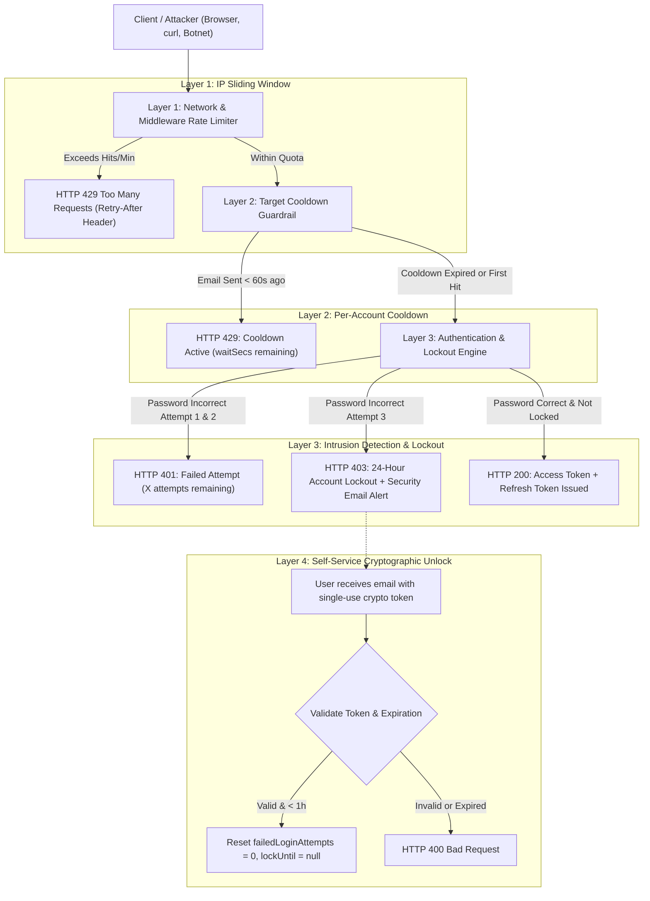
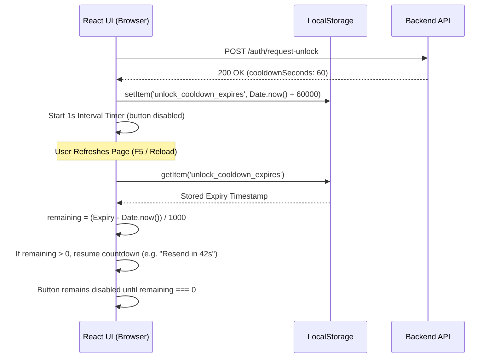

# 🛡️ Enterprise Authentication & Threat Mitigation Architecture Blueprint

> **A Comprehensive Specification for Denial-of-Service (DoS), Password Brute-Force, and Credential-Stuffing Defense**
> *Designed for scalable web applications, API gateways, and multi-tenant platforms.*

---

## 📑 Table of Contents
1. [Executive Summary & Security Philosophy](#1-executive-summary--security-philosophy)
2. [Threat Model & Attack Vectors Addressed](#2-threat-model--attack-vectors-addressed)
3. [Defense-in-Depth Architecture Overview](#3-defense-in-depth-architecture-overview)
4. [Layer 1: Network & Middleware Sliding-Window Rate Limiting (DoS/DDoS Defense)](#4-layer-1-network--middleware-sliding-window-rate-limiting-dosddos-defense)
5. [Layer 2: Target-Account Email Cooldown (Spam Bombing Defense)](#5-layer-2-target-account-email-cooldown-spam-bombing-defense)
6. [Layer 3: Brute-Force Lockout & Automated Intrusion Detection](#6-layer-3-brute-force-lockout--automated-intrusion-detection)
7. [Layer 4: Self-Service Cryptographic Unlock Protocol](#7-layer-4-self-service-cryptographic-unlock-protocol)
8. [Layer 5: Safe Password Reset Architecture & Anti-Enumeration](#8-layer-5-safe-password-reset-architecture--anti-enumeration)
9. [Layer 6: Session Management & Cryptographic Token Security](#9-layer-6-session-management--cryptographic-token-security)
10. [Layer 7: Client-Side Resilience & Persistent Cooldown Timers](#10-layer-7-client-side-resilience--persistent-cooldown-timers)
11. [Database Schema & Data Model Specifications](#11-database-schema--data-model-specifications)
12. [API Contract & HTTP Status Codes Reference](#12-api-contract--http-status-codes-reference)
13. [Step-by-Step Implementation Guide for Other Projects](#13-step-by-step-implementation-guide-for-other-projects)

---

## 1. Executive Summary & Security Philosophy

Modern web applications face continuous automated attacks: credential stuffing bots, password sprayers, distributed denial-of-service (DDoS) scanners, and malicious email bombing scripts. Traditional defenses—such as simple IP blocking or captcha challenges—fail when attackers rotate proxy IPs or trigger email endpoints to exhaust third-party SMTP quotas and harass users.

This blueprint documents the **multi-layered, defense-in-depth authentication security system** engineered for this application. It enforces zero trust across every entry point without sacrificing legitimate user experience.

### Core Security Tenets
1. **Never Rely on Client State Alone:** Frontends can be bypassed via direct HTTP calls (`curl`, Postman, automated headless scripts). Every restriction (rate limiting, cooldowns, attempts) MUST be enforced server-side.
2. **Dual-Tier Throttling:** Throttle both by **Origin IP** (to prevent resource exhaustion) and by **Target Account / Identity** (to prevent targeted spam bombing across distributed botnets).
3. **Fail Safely Without Information Leakage:** Never reveal whether an account exists during forgot-password or unlock requests (Anti-Enumeration).
4. **Actionable Intrusion Context:** When suspicious activity triggers security measures, provide the legitimate user with transparent forensic data (IP, Geolocation, Device/Browser, Exact Timestamp).
5. **Fail-Closed Locking with Self-Service Recovery:** Freeze compromised targets immediately, but allow legitimate owners to recover access quickly using single-use, high-entropy cryptographic links.

---

## 2. Threat Model & Attack Vectors Addressed

| Threat / Attack Vector | Attack Mechanics | Traditional Vulnerability | Blueprint Defense Strategy |
| :--- | :--- | :--- | :--- |
| **Password Brute-Force & Spraying** | Automated dictionaries trying passwords against single or multiple accounts. | Unlimited tries or simple delay timers. | **3-Strike 24-Hour Account Lockdown** + IP penalty sliding window. |
| **API Denial of Service (DoS / DDoS)** | Thousands of rapid requests hitting authentication endpoints to exhaust DB connections and CPU. | CPU starvation, memory leaks, thread starvation. | **Sliding Window IP Throttler** with automatic memory garbage collection. |
| **Email Inbox Spam Bombing** | Attackers repeatedly triggering "Forgot Password" or "Unlock" to flood a victim's email inbox. | Client-only button disabling; backend allows endless loops. | **Target Account 60-Second Cooldown** enforced at the Database level. |
| **Account Enumeration / Discovery** | Probing `/forgot-password` or `/request-unlock` to see if a username/email exists. | Returning `"User not found"` (HTTP 404). | **Uniform Timing & Generic Responses** (HTTP 200 with identical messages). |
| **Token Replay & Stale Token Abuse** | Using expired or already-used unlock/reset links to hijack sessions. | Tokens stored without expiration or not invalidated on consumption. | **Single-Use Crypto Hex Tokens (32 bytes)** with 1-hour expiration and atomic clearance. |
| **Client Page-Refresh Bypass** | Users or automated clicks refreshing the browser to clear React state and re-send emails. | In-memory component state (`useState`) lost on reload. | **Persistent LocalStorage Synchronization** with auto-resumed countdown timers. |

---

## 3. Defense-in-Depth Architecture Overview



---

## 4. Layer 1: Network & Middleware Sliding-Window Rate Limiting (DoS/DDoS Defense)

### 4.1 Mechanism
Rather than static counters that reset at arbitrary clock boundaries (which allow attackers to burst at the end of a minute), our system utilizes a **Sliding Window Log** algorithm tracked per client IP address.

### 4.2 Endpoint Rate Allocations
Different authentication endpoints have different risk profiles and require distinct hit thresholds:

| Endpoint | Method | Max Hits / Min | Justification |
| :--- | :---: | :---: | :--- |
| `/api/auth/login` | `POST` | **15 hits/min** | Allows normal typing mistakes while stopping automated dictionary attacks. |
| `/api/auth/admin/login` | `POST` | **10 hits/min** | High-privilege zone; tighter threshold for administrator accounts. |
| `/api/auth/register` | `POST` | **10 hits/min** | Prevents mass account creation and bot spam. |
| `/api/auth/forgot-password` | `POST` | **5 hits/min** | Heavy endpoint (triggers cryptographic generation + SMTP relay). |
| `/api/auth/request-unlock` | `POST` | **5 hits/min** | Heavy endpoint (triggers cryptographic generation + SMTP relay). |
| `/api/auth/reset-password` | `POST` | **10 hits/min** | Protects token validation and password hashing compute cycles. |

### 4.3 Node.js / Express Middleware Implementation Pattern
```javascript
// src/middlewares/authRateLimiter.middleware.js
class AuthRateLimiter {
    constructor() {
        this.ipHits = new Map(); // ip -> [timestamp1, timestamp2, ...]
        this.ipFailedAttempts = new Map(); // ip -> { count, firstFailedAt, blockUntil }

        // Self-cleaning memory garbage collection every 5 minutes
        const sweeper = setInterval(() => this.cleanup(), 5 * 60 * 1000);
        if (sweeper.unref) sweeper.unref();
    }

    getClientIp(req) {
        return (
            req.headers["x-forwarded-for"]?.split(",")[0]?.trim() ||
            req.headers["x-real-ip"] ||
            req.socket?.remoteAddress ||
            req.ip ||
            "unknown_ip"
        );
    }

    middleware({ maxHitsPerMinute = 15, blockDurationMs = 15 * 60 * 1000 } = {}) {
        return (req, res, next) => {
            const ip = this.getClientIp(req);
            const now = Date.now();

            // 1. Check IP-level penalty block
            const failedRecord = this.ipFailedAttempts.get(ip);
            if (failedRecord?.blockUntil && failedRecord.blockUntil > now) {
                const waitSecs = Math.ceil((failedRecord.blockUntil - now) / 1000);
                res.setHeader("Retry-After", waitSecs);
                return res.status(429).json({
                    statusCode: 429,
                    success: false,
                    message: `Too many failed attempts from your IP. Brute-force protection activated. Please wait ${waitSecs}s.`,
                });
            }

            // 2. Sliding window check
            let timestamps = (this.ipHits.get(ip) || []).filter(t => now - t < 60 * 1000);
            if (timestamps.length >= maxHitsPerMinute) {
                res.setHeader("Retry-After", 60);
                return res.status(429).json({
                    statusCode: 429,
                    success: false,
                    message: "Too many authentication requests from this network. Rate limit exceeded.",
                });
            }

            timestamps.push(now);
            this.ipHits.set(ip, timestamps);
            next();
        };
    }
}
```

---

## 5. Layer 2: Target-Account Email Cooldown (Spam Bombing Defense)

### 5.1 The Vulnerability of IP-Only Rate Limiting
If an attacker uses a distributed proxy network (1,000 rotating IPs), each request comes from a new IP, bypassing Layer 1. If each proxy requests a password reset or unlock link for `victim@example.com`, the victim receives 1,000 emails in seconds. This:
- Exhausts transactional email quotas (SendGrid, AWS SES, Titan, Resend).
- Leads to domain blacklisting and spam flag penalties.
- Denies service to legitimate recipients.

### 5.2 The Blueprint Solution: Identity-Level Cooldown
Regardless of which IP triggers the request, the database records the exact timestamp of the last email dispatched to that user:
- `lastUnlockEmailSentAt: Date`
- `lastPasswordResetEmailSentAt: Date`

Before dispatching an email, the backend evaluates:
$$\Delta t = \text{currentTime} - \text{lastEmailSentAt}$$

If $\Delta t < 60\text{ seconds}$, the request is rejected immediately:
```javascript
const COOLDOWN_SECONDS = 60;
if (user.lastUnlockEmailSentAt) {
    const elapsedMs = Date.now() - new Date(user.lastUnlockEmailSentAt).getTime();
    const cooldownMs = COOLDOWN_SECONDS * 1000;
    if (elapsedMs < cooldownMs) {
        const waitSecs = Math.ceil((cooldownMs - elapsedMs) / 1000);
        const err = new ApiError(
            httpStatus.TOO_MANY_REQUESTS,
            `Please wait ${waitSecs} second${waitSecs === 1 ? "" : "s"} before requesting another unlock link.`
        );
        err.cooldownSeconds = waitSecs;
        err.data = { cooldownSeconds: waitSecs, retryAfter: waitSecs };
        throw err;
    }
}
```

---

## 6. Layer 3: Brute-Force Lockout & Automated Intrusion Detection

### 6.1 Progressive Warning Thresholds
- **Attempt 1:** Password verification fails $\to$ `failedLoginAttempts = 1`.  
  Response (HTTP 401): `"Incorrect password. 2 attempt(s) remaining before a 24-hour account lockout."`
- **Attempt 2:** Password verification fails $\to$ `failedLoginAttempts = 2`.  
  Response (HTTP 401): `"Incorrect password. 1 attempt(s) remaining before a 24-hour account lockout."`
- **Attempt 3:** Password verification fails $\to$ `failedLoginAttempts = 3`.  
  Account state updated:
  $$\text{lockUntil} = \text{Date.now()} + 24 \times 3600 \times 1000 \text{ ms (24 hours)}$$
  Response (HTTP 403): `"Account has been temporarily locked for 24 hours due to 3 consecutive failed login attempts."`

### 6.2 Automatic Threat Alert Dispatch
When the 3rd failed attempt locks the account, the backend asynchronously extracts threat metadata and alerts the user:
1. **IP Address:** Real client IP resolved through proxies (`X-Forwarded-For`).
2. **User-Agent Parsing:** Parsed using `ua-parser-js` into Browser (`Chrome 122`), OS (`Windows 11`), Device (`Desktop`).
3. **Geolocation:** Country, City, Region mapped via IP geolocation utilities.
4. **Actionable Recovery Links:** Contains an **Unlock Link** and a **Reset Password Link**.

> [!IMPORTANT]
> **The Critical Security Rule in Notifications:**
> The email explicitly instructs the user:
> - *If you REMEMBER your password:* Click "Unlock Account" to restore access.
> - *If you DO NOT REMEMBER your password:* Click "Reset Password".
> 
> *Rationale:* If a user unlocks the account without changing their password and enters the wrong password again, the 24-hour lockout triggers immediately on Attempt 1.

---

## 7. Layer 4: Self-Service Cryptographic Unlock Protocol

### 7.1 Cryptographic Token Architecture
- Generated using cryptographically strong pseudo-random data:
  ```javascript
  const unlockToken = crypto.randomBytes(32).toString("hex"); // 64-character hex string (256 bits entropy)
  ```
- Expiration: Strictly limited to **1 hour** (`Date.now() + 3600 * 1000`).
- Indexed sparse lookup in MongoDB / SQL:
  ```javascript
  user.unlockAccountToken = unlockToken;
  user.unlockAccountTokenExpiresAt = new Date(Date.now() + 3600 * 1000);
  await user.save();
  ```

### 7.2 Atomic Token Consumption & State Reset
When the user visits `/api/auth/unlock-account?token=...`:
1. Find user matching `unlockAccountToken === token`.
2. Verify `unlockAccountTokenExpiresAt > new Date()`.
3. In a single atomic operation:
   - `failedLoginAttempts = 0`
   - `lockUntil = null`
   - `unlockAccountToken = null`
   - `unlockAccountTokenExpiresAt = null`
   - `lastUnlockEmailSentAt = null`
4. Redirect user to `/app-manager/sign-in?unlocked=true` with a success toast.

---

## 8. Layer 5: Safe Password Reset Architecture & Anti-Enumeration

### 8.1 Anti-Enumeration (Blind Success Responses)
If an attacker tests 10,000 email addresses on `/api/auth/forgot-password`:
- **Insecure System:** Returns `HTTP 404 User Not Found` (reveals whether the target is registered).
- **Hardened System:** Always returns `HTTP 200 OK`:
  ```json
  {
    "statusCode": 200,
    "success": true,
    "message": "If an account exists with that email, a password reset link has been dispatched."
  }
  ```
  No email is sent for non-existent users, but the attacker receives identical status codes and timing.

### 8.2 Password Update Cleanup
When a user sets a new password via `/api/auth/reset-password`:
1. Hash password with **Bcrypt** (minimum 10 salt rounds).
2. Wipe `passwordResetToken` and `passwordResetTokenExpiresAt`.
3. Clear all lockout state (`lockUntil = null`, `failedLoginAttempts = 0`, `unlockAccountToken = null`).
4. Invalidate existing session tokens to force re-authentication across all devices.

---

## 9. Layer 6: Session Management & Cryptographic Token Security

```
+-------------------------------------------------------------+
|                      JWT Auth System                        |
|                                                             |
|  [ Access Token ]  (15 Minutes, In-Memory)                  |
|    - Payload: { id, role, orgId, jti: "<uuid-v4>" }         |
|    - Verified using: config.jwt.secret                      |
|                                                             |
|  [ Refresh Token ] (7 Days, HttpOnly Cookie or Secure Body) |
|    - Payload: { id, jti: "<session-token-id>", type: "refresh" } |
|    - Verified using: config.jwt.refreshSecret               |
|    - Validated against DB active sessions array             |
+-------------------------------------------------------------+
```

### 9.1 Session Invalidation (`jti` Tracking)
- Every login generates a unique session `tokenId` (`uuidv4`).
- Stored in the `User.sessions` array:
  ```javascript
  {
    tokenId: "b548bfe4-8392-4ce0-...",
    refreshToken: "...",
    deviceInfo: { browser: "Chrome", os: "Windows", device: "desktop" },
    ipAddress: "192.168.1.1",
    loginAt: ISODate("..."),
    expiresAt: ISODate("..."),
    isActive: true
  }
  ```
- **Instant Revocation:** Calling `/logout` or `/revoke-session` removes the matching `tokenId` from the array. Even if the refresh token is unexpired, subsequent refreshes are rejected with `HTTP 401 Unauthorized`.

---

## 10. Layer 7: Client-Side Resilience & Persistent Cooldown Timers

### 10.1 The Page Reload Problem
If a button shows a 60-second cooldown in local React state (`useState(60)`), refreshing the browser tab resets state to 0, tempting the user to spam click.

### 10.2 The Persistent Storage Protocol


### 10.3 Code Template for Frontends
```tsx
const COOLDOWN_KEY = 'auth_email_cooldown_expires';

export function CooldownButton({ onSend }: { onSend: () => Promise<void> }) {
  const [cooldown, setCooldown] = useState(0);

  // 1. Restore across page refreshes
  useEffect(() => {
    try {
      const stored = localStorage.getItem(COOLDOWN_KEY);
      if (stored) {
        const remaining = Math.ceil((Number(stored) - Date.now()) / 1000);
        if (remaining > 0) setCooldown(remaining);
        else localStorage.removeItem(COOLDOWN_KEY);
      }
    } catch (_) {}
  }, []);

  // 2. Ticking interval
  useEffect(() => {
    if (cooldown <= 0) return;
    const timer = setInterval(() => {
      setCooldown((prev) => {
        if (prev <= 1) {
          localStorage.removeItem(COOLDOWN_KEY);
          return 0;
        }
        return prev - 1;
      });
    }, 1000);
    return () => clearInterval(timer);
  }, [cooldown]);

  const handleAction = async () => {
    if (cooldown > 0) return;
    try {
      await onSend();
      const secs = 60;
      setCooldown(secs);
      localStorage.setItem(COOLDOWN_KEY, (Date.now() + secs * 1000).toString());
    } catch (err: any) {
      if (err?.response?.status === 429) {
        const serverSecs = err?.response?.data?.data?.cooldownSeconds || 60;
        setCooldown(serverSecs);
        localStorage.setItem(COOLDOWN_KEY, (Date.now() + serverSecs * 1000).toString());
      }
    }
  };

  return (
    <button disabled={cooldown > 0} onClick={handleAction}>
      {cooldown > 0 ? `Resend in ${cooldown}s` : 'Send Link'}
    </button>
  );
}
```

---

## 11. Database Schema & Data Model Specifications

### Mongoose (MongoDB) User Model Integration
```javascript
const userSecurityFields = {
    // Brute-force & Lockout tracking
    failedLoginAttempts: {
        type: Number,
        default: 0,
        index: true,
    },
    lockUntil: {
        type: Date,
        default: null,
        index: true,
    },
    lastFailedLoginAt: {
        type: Date,
        default: null,
    },
    lastFailedLoginIp: {
        type: String,
        default: null,
    },

    // Self-service account unlock token
    unlockAccountToken: {
        type: String,
        default: null,
        index: true,
    },
    unlockAccountTokenExpiresAt: {
        type: Date,
        default: null,
    },
    lastUnlockEmailSentAt: {
        type: Date,
        default: null,
    },

    // Password reset token
    passwordResetToken: {
        type: String,
        default: null,
        index: true,
    },
    passwordResetTokenExpiresAt: {
        type: Date,
        default: null,
    },
    lastPasswordResetEmailSentAt: {
        type: Date,
        default: null,
    },
};

// Model Helper Methods
userSchema.methods.isLocked = function () {
    return Boolean(this.lockUntil && this.lockUntil > new Date());
};

userSchema.methods.unlockAccount = async function () {
    this.failedLoginAttempts = 0;
    this.lockUntil = null;
    this.unlockAccountToken = null;
    this.unlockAccountTokenExpiresAt = null;
    this.lastUnlockEmailSentAt = null;
    return this.save();
};
```

---

## 12. API Contract & HTTP Status Codes Reference

| Endpoint | Method | Status | Scenario / Description | JSON Payload Format |
| :--- | :---: | :---: | :--- | :--- |
| `/api/auth/login` | `POST` | `200` | Successful credentials verification. | `{ statusCode: 200, success: true, data: { accessToken, refreshToken, user } }` |
| `/api/auth/login` | `POST` | `401` | Password incorrect (attempts remaining). | `{ statusCode: 401, success: false, message: "Incorrect password. 2 attempt(s) remaining..." }` |
| `/api/auth/login` | `POST` | `403` | Account temporarily locked (3 failed attempts). | `{ statusCode: 403, success: false, message: "Account has been temporarily locked for 24 hours..." }` |
| `/api/auth/login` | `POST` | `429` | IP network hit rate limit exceeded. | `{ statusCode: 429, success: false, message: "Too many login requests from this network..." }` |
| `/api/auth/forgot-password` | `POST` | `200` | Reset link dispatched (or blind success). | `{ statusCode: 200, success: true, message: "...", data: { cooldownSeconds: 60 } }` |
| `/api/auth/forgot-password` | `POST` | `429` | Requested within 60s cooldown period. | `{ statusCode: 429, success: false, message: "Please wait 45s...", data: { cooldownSeconds: 45 } }` |
| `/api/auth/request-unlock` | `POST` | `200` | Unlock email dispatched. | `{ statusCode: 200, success: true, message: "...", data: { isLocked: true, cooldownSeconds: 60 } }` |
| `/api/auth/request-unlock` | `POST` | `429` | Requested within 60s cooldown period. | `{ statusCode: 429, success: false, message: "Please wait 50s...", data: { cooldownSeconds: 50 } }` |
| `/api/auth/unlock-account` | `GET/POST`| `200` | Token valid; account unlocked. | `{ statusCode: 200, success: true, message: "Account successfully unlocked." }` |
| `/api/auth/unlock-account` | `GET/POST`| `400` | Token is invalid, tampered, or expired. | `{ statusCode: 400, success: false, message: "Unlock token is invalid or has expired." }` |

---

## 13. Step-by-Step Implementation Guide for Other Projects

To replicate this security architecture in any other Node.js / Python / Go / Java application:

### Step 1: Database Migration
Add the 10 core fields to your User entity:
- `failed_login_attempts` (integer, default 0)
- `lock_until` (timestamp/datetime, nullable)
- `unlock_account_token` (string 64, nullable, indexed)
- `unlock_account_token_expires_at` (timestamp, nullable)
- `last_unlock_email_sent_at` (timestamp, nullable)
- `password_reset_token` (string 64, nullable, indexed)
- `password_reset_token_expires_at` (timestamp, nullable)
- `last_password_reset_email_sent_at` (timestamp, nullable)
- `last_failed_login_at` (timestamp, nullable)
- `last_failed_login_ip` (string, nullable)

### Step 2: Rate Limiter Middleware
Install or configure Redis / in-memory sliding window limiter:
- Apply `maxHitsPerMinute: 15` on login routes.
- Apply `maxHitsPerMinute: 5` on email dispatch routes.
- Emit standard `Retry-After: <seconds>` headers on HTTP 429.

### Step 3: Service-Level Email Cooldowns
Wrap all transactional email dispatch functions with a 60-second database check:
```javascript
if (user.lastEmailSentAt && (Date.now() - user.lastEmailSentAt.getTime()) < 60000) {
    throw new TooManyRequestsException("Cooldown active");
}
```

### Step 4: Login Counter & Threat Notifier
In the login credential verification service:
1. If password matches: `failedLoginAttempts = 0; lockUntil = null;`
2. If password fails: `failedLoginAttempts += 1;`
3. If `failedLoginAttempts >= 3`:
   - Set `lockUntil = now + 24 hours`
   - Trigger security alert email containing client IP, OS, Browser, Geolocation, and unlock token.

### Step 5: Frontend LocalStorage Synchronization
Add the `localStorage` countdown hook to all forms containing "Resend" or "Send Link" buttons to prevent client-side spamming and ensure consistent UX across reloads.
