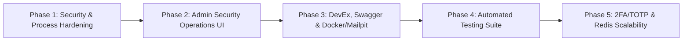

# 🚀 Enterprise Production Roadmap: Step-by-Step Implementation Guide

> **A Comprehensive Engineering Plan for Security Hardening, Admin Security Operations, Developer Experience, Testing, and Advanced 2FA Capabilities.**  
> *Target Repository: `Backend-Boilerplate-MongoDB-Express`*

---

## 📑 Roadmap Overview & Execution Phases



| Phase | Core Objective | Key Deliverables | Estimated Complexity |
| :--- | :--- | :--- | :--- |
| **Phase 1** | **Security & Process Hardening** | NoSQL sanitizer, Helmet + HSTS, Password complexity regex, Graceful shutdown handlers | Low-Medium (Quick wins) |
| **Phase 2** | **Admin Security Operations UI** | "Security & Locked Accounts" tab in React Admin SPA, 1-Click Unlock, Forensic metadata inspection, Session manager | Medium |
| **Phase 3** | **DevEx, Swagger & Docker Stack** | OpenAPI/Swagger interactive UI (`/api-docs`), `Dockerfile`, `docker-compose.yml` (App + Mongo + Mailpit on `:8025`) | Medium |
| **Phase 4** | **Automated Integration Testing** | Vitest/Jest + Supertest suite with `mongodb-memory-server` testing all 7 defense layers | Medium-High |
| **Phase 5** | **2FA / TOTP & Redis Scalability** | Authenticator app 2FA (QR code setup, recovery codes, step-up login), optional Redis rate-limiter adapter | High |

---

## Phase 1: Security & Process Hardening

### 1.1 NoSQL Query Injection Sanitizer
* **Problem**: Express 5 does not automatically sanitize query parameters or request bodies containing MongoDB operators (`$gt`, `$ne`, `$regex`, `$where`). Attackers can send `{"email": {"$gt": ""}}` to bypass query logic.
* **Implementation**:
  * Create `src/middlewares/sanitize.middleware.js`.
  * Recursively traverse `req.body`, `req.query`, and `req.params`.
  * Strip or replace any object keys beginning with `$` or containing `.`.
  * Mount globally in `src/app.js` right after `express.json()` and `express.urlencoded()`.

```javascript
// src/middlewares/sanitize.middleware.js
const cleanObject = (obj) => {
    if (!obj || typeof obj !== "object") return obj;
    if (Array.isArray(obj)) return obj.map(cleanObject);
    
    const sanitized = {};
    for (const [key, val] of Object.entries(obj)) {
        if (!key.startsWith("$") && !key.includes(".")) {
            sanitized[key] = cleanObject(val);
        }
    }
    return sanitized;
};

export const sanitizeInputs = (req, res, next) => {
    if (req.body) req.body = cleanObject(req.body);
    if (req.query) req.query = cleanObject(req.query);
    if (req.params) req.params = cleanObject(req.params);
    next();
};
```

### 1.2 Enterprise HTTP Security Headers (Helmet + HSTS)
* **Problem**: Manual custom headers only cover basic scenarios. Helmet provides production-tested defaults: HSTS (`Strict-Transport-Security`), DNS prefetch controls, X-Download-Options, frameguard, and CSP.
* **Implementation**:
  * Install `helmet`.
  * In `src/app.js`, configure `helmet` with custom Content Security Policy (CSP) compatible with the built Admin SPA assets (`'self'`, Google Fonts, and inline SVGs/styles used by Tailwind/Radix UI).

### 1.3 Enterprise Password Complexity Enforcement
* **Problem**: Currently `auth.validation.js` only checks `min(8)`. Weak passwords like `password123` easily pass.
* **Implementation**:
  * Update `src/validations/auth.validation.js`:
  * Enforce regex: At least 8 characters, 1 uppercase letter, 1 lowercase letter, 1 number, and 1 special character (`!@#$%^&*(),.?":{}|<>`).

```javascript
const passwordComplexityRegex = /^(?=.*[a-z])(?=.*[A-Z])(?=.*\d)(?=.*[!@#$%^&*()_+\-=[\]{};':"\\|,.<>/?]).{8,}$/;
const passwordValidationMessage = "Password must be at least 8 characters long and contain at least one uppercase letter, one lowercase letter, one number, and one special character.";

// Applied to register, resetPassword, and changePassword schemas:
password: Joi.string().required().regex(passwordComplexityRegex).messages({
    "string.pattern.base": passwordValidationMessage,
});
```

### 1.4 Graceful Process Shutdown & Signal Lifecycle
* **Problem**: Sudden process kills (`SIGINT`, `SIGTERM`, unhandled exceptions) drop open MongoDB connection pools and disrupt live Socket.IO client connections.
* **Implementation**:
  * In `src/index.js`, attach signal listeners:
    * Close the HTTP/Socket.IO server (`server.close()`).
    * Disconnect from Mongoose (`mongoose.connection.close(false)`).
    * Flush file logs.
    * Terminate gracefully with exit code 0 (or 1 for unhandled exceptions).

---

## Phase 2: Admin Dashboard - Security Operations UI

### 2.1 Backend Endpoints Already Ready
* `GET /api/user/admin/locked-users` — Returns array of currently locked user documents with forensic metadata.
* `POST /api/user/admin/unlock/:userId` — 1-click admin unlock which resets `failedLoginAttempts: 0`, `lockUntil: null`, and clears unlock tokens.

### 2.2 Client API Integration
* In `frontend/apps/admin/src/api/client.js`, add:
  * `api.getLockedUsers()`
  * `api.adminUnlockUser(userId)`
  * `api.getUserSessions(userId)`
  * `api.revokeUserSession(userId, sessionId)`

### 2.3 New Security Management View (`SecurityView.jsx`)
* Create `frontend/apps/admin/src/components/views/SecurityView.jsx`:
  * **Top Summary Stats**: Total Locked Accounts, Recent Failed Attacks, Active Sessions.
  * **Interactive Table of Locked Accounts**:
    * User Full Name, Email, Role.
    * Failed Attempt Count (e.g. `3 strikes`).
    * Lock Expiration Countdown (e.g. `Expires in 23h 45m`).
    * Intrusion Forensic Details: Last Failed IP, User-Agent, Timestamp.
    * **Action**: **"Unlock Account" Button** with instant status refresh.
  * **Search & Filter**: Filter by email, IP, or lock status.

### 2.4 Navigation & App Integration
* In `frontend/apps/admin/src/App.jsx`:
  * Add `/admin/security` route.
  * Add `ShieldAlert` icon to the main navigation header in `Header.jsx`.
* Rebuild admin bundle (`pnpm run build:admin`) to deploy directly into `public/admin`.

---

## Phase 3: Developer Experience, Swagger UI & Docker/Mailpit Stack

### 3.1 Interactive OpenAPI / Swagger Documentation
* **Problem**: Developers integrating with the boilerplate currently have to inspect routes manually.
* **Implementation**:
  * Install `swagger-ui-express` and `swagger-jsdoc` (or generate static OpenAPI JSON spec).
  * Expose route `GET /api-docs` serving an interactive Swagger interface.
  * Document all core authentication endpoints:
    * `/api/auth/login` (request body, 200 success, 401 failed attempt, 403 lockout).
    * `/api/auth/register`
    * `/api/auth/forgot-password`
    * `/api/auth/reset-password`
    * `/api/auth/request-unlock`
    * `/api/auth/unlock-account`
    * `/api/auth/refresh-token`
    * Admin security & log endpoints.

### 3.2 Turnkey Local Stack with Docker & Mailpit
* **Problem**: In local development, developers usually don't have configured SMTP credentials, relying on terminal logs. Mailpit provides a full local SMTP server with a webmail inbox UI.
* **Implementation**:
  * Create `docker/Dockerfile`: Multi-stage build for Node.js app + admin frontend assets.
  * Create `docker-compose.yml`:
    * `app`: Node.js Express server mapped to `localhost:3000`.
    * `mongo`: MongoDB 7.0 container with persistent volume mapped to `localhost:27017`.
    * `mailpit`: Lightweight SMTP server receiving emails on port `1025` and displaying interactive webmail on `http://localhost:8025`.
  * Update `.env.example` with Mailpit configuration defaults:
    ```env
    EMAIL_HOST=localhost
    EMAIL_PORT=1025
    EMAIL_SECURE=false
    EMAIL_ID=noreply@boilerplate.local
    EMAIL_PASSWORD=
    ```

---

## Phase 4: Automated Integration Testing Suite

### 4.1 Test Infrastructure Setup
* **Tooling**: `vitest` (fast ESM-native test runner) + `supertest` (HTTP assertions) + `mongodb-memory-server` (isolated, fast, zero-external-dependency DB).
* **Configuration**: `vitest.config.js` running in Node environment.

### 4.2 Test Matrix

```
tests/
├── integration/
│   ├── auth.lockout.test.js       # Verifies 3 strikes = 403 Lockout
│   ├── auth.rateLimit.test.js     # Verifies 15 req/min IP sliding window
│   ├── auth.unlock.test.js        # Verifies cryptographic token reset
│   ├── auth.cooldown.test.js      # Verifies 60s per-target account throttling
│   └── auth.sessions.test.js      # Verifies token revocation and logout
└── unit/
    ├── sanitize.test.js           # Verifies NoSQL operator stripping
    └── passwordComplexity.test.js # Verifies Joi regex validation
```

### 4.3 Key Test Scenarios
1. **Brute-Force Lockout (`auth.lockout.test.js`)**:
   - Send 2 incorrect passwords -> Receive HTTP `401` with remaining attempt count.
   - Send 3rd incorrect password -> Receive HTTP `403` with `isLocked: true`, `lockUntil` timestamp, and no token leakage.
2. **Account Cooldown (`auth.cooldown.test.js`)**:
   - Call `/api/auth/request-unlock` -> Receive HTTP `200` (`cooldownSeconds: 60`).
   - Call `/api/auth/request-unlock` immediately again -> Receive HTTP `429` (`cooldownSeconds > 0`).
3. **Cryptographic Token Verification (`auth.unlock.test.js`)**:
   - Query DB for user's generated `unlockAccountToken`.
   - Call `GET /api/auth/unlock-account?token=...`.
   - Verify DB updates: `failedLoginAttempts === 0` and `lockUntil === null`.

---

## Phase 5: Two-Factor Authentication (2FA / TOTP) & Redis Scalability

### 5.1 Two-Factor Authentication (TOTP)
* **Library**: `otplib` (standard RFC 6238 TOTP) + `qrcode` (generates data URLs for authenticator apps like Google Authenticator / Authy).
* **User Schema Updates** in `src/models/user.model.js`:
  * `twoFactorEnabled`: `{ type: Boolean, default: false }`
  * `twoFactorSecret`: `{ type: String, select: false }` (encrypted/hashed)
  * `twoFactorRecoveryCodes`: `[{ code: String, used: Boolean }]`
* **Endpoints**:
  * `POST /api/auth/2fa/setup` (Generates secret and QR code URL).
  * `POST /api/auth/2fa/verify` (Validates 6-digit TOTP code and activates 2FA).
  * `POST /api/auth/2fa/disable` (Disables 2FA with password confirmation).
  * `POST /api/auth/2fa/login` (Step-up authentication: exchanges temporary 2FA token + 6-digit code for final JWT access & refresh tokens).

### 5.2 Optional Redis Adapter for Distributed Rate Limiting
* **Problem**: In-memory Map sliding window works for single-node instances. Horizontal scaling across multiple containers or Kubernetes pods requires a shared store.
* **Implementation**:
  * In `src/middlewares/authRateLimiter.middleware.js`, add optional Redis client detection via `REDIS_URL`.
  * If `REDIS_URL` is set, execute sliding window using Redis Sorted Sets (`ZADD`, `ZREMRANGEBYSCORE`, `ZCARD`, `EXPIRE`).
  * If `REDIS_URL` is not set, automatically fall back to the built-in zero-dependency in-memory Map.

---

## 📅 Recommended Implementation Sequence

```
┌─────────────────────────────────────────────────────────────┐
│ STEP 1: Phase 1 — Security & Process Hardening              │
│ (NoSQL sanitizer, Helmet, password regex, graceful shutdown) │
└──────────────────────────────┬──────────────────────────────┘
                               │
┌──────────────────────────────▼──────────────────────────────┐
│ STEP 2: Phase 2 — Admin Security Operations UI               │
│ (SecurityView.jsx, locked users table, 1-click unlock button)│
└──────────────────────────────┬──────────────────────────────┘
                               │
┌──────────────────────────────▼──────────────────────────────┐
│ STEP 3: Phase 3 — Developer Experience (Swagger & Docker)    │
│ (/api-docs interactive UI, Dockerfile, docker-compose stack)│
└──────────────────────────────┬──────────────────────────────┘
                               │
┌──────────────────────────────▼──────────────────────────────┐
│ STEP 4: Phase 4 — Automated Test Suite (Vitest + Supertest)  │
│ (Automated tests for lockout, rate limits, and tokens)       │
└──────────────────────────────┬──────────────────────────────┘
                               │
┌──────────────────────────────▼──────────────────────────────┐
│ STEP 5: Phase 5 — 2FA / TOTP Authenticator Integration       │
│ (QR code generation, 6-digit verification, recovery codes)   │
└─────────────────────────────────────────────────────────────┘
```
